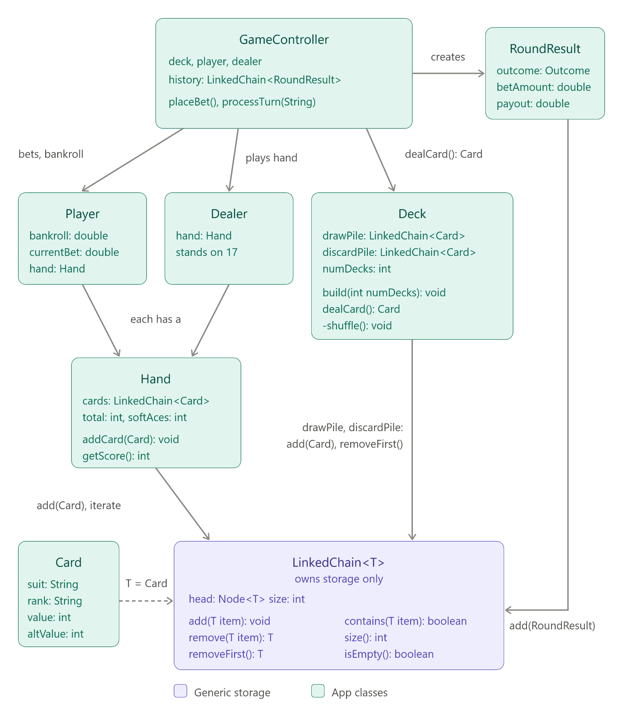

# cs2114-project2-group87

A console Blackjack game where you bet against a computer dealer, with splitting, insurance, and power-ups, all stored in a generic LinkedChain.

## Team

- Sami Saleh
- Pratham Singh
- Angelina Gust
- Tien Vu

## Compile and Run

All classes are in `src` in the default package. Compile and play the game:

    javac -d bin -sourcepath src src/GameController.java
    java -cp bin GameController

The tests are the `*Test.java` files in `src`. They use `student.TestCase`
from the CS2114 student library, so the easiest way to run them is in
Eclipse with the CS2-Support project on the build path: right-click `src`
and pick Run As > JUnit Test.

To compile and run them from the command line instead, put the student
library and JUnit on the classpath:

    javac -cp path/to/student.jar -d bin src/*.java
    java -cp bin:path/to/student.jar:path/to/junit.jar junit.textui.TestRunner PlayerTest

`bin` is build output. Do not commit it.

## System Diagram

LinkedChain<T> holds Card in the draw pile, discard pile, and hands,
RoundResult in the history log, and String in the power-up inventory.

## Attribution

| File                    | Who                     | How                                                          |
| ----------------------- | ----------------------- | ------------------------------------------------------------ |
| LinkedChain.java        | Sami Saleh              | Given, modified by Sami: added removeFirst and changed remove(T), GenAI-assisted |
| LinkedChainTest.java    | Sami Saleh              | wrote, GenAI-assisted                                        |
| Card.java               | Sami Saleh              | wrote, GenAI-assisted                                        |
| CardTest.java           | Sami Saleh              | wrote, GenAI-assisted                                        |
| Player.java             | Pratham Singh           | wrote, GenAI-assisted                                        |
| PlayerTest.java         | Pratham Singh           | wrote, GenAI-assisted                                        |
| GameController.java     | Pratham Singh           | wrote, GenAI-assisted                                        |
| GameControllerTest.java | Pratham Singh           | wrote, GenAI-assisted                                        |
| Hand.java               | Angelina Gust           | wrote, GenAI-assisted                                        |
| HandTest.java           | Angelina Gust           | wrote, GenAI-assisted                                        |
| Dealer.java             | Angelina Gust           | wrote, GenAI-assisted                                        |
| DealerTest.java         | Angelina Gust           | wrote, GenAI-assisted                                        |
| RoundResult.java        | Tien Vu                 | wrote, GenAI-assisted                                        |
| RoundResultTest.java    | Tien Vu                 | wrote, GenAI-assisted                                        |
| Deck.java               | Tien Vu                 | wrote, GenAI-assisted                                        |
| DeckTest.java           | Tien Vu                 | wrote, GenAI-assisted                                        |

GenAI: Sami, Tien, Pratham, and Angelina used Claude to help plan out writing classes and their tests, making sure to verify with spec before planning. We reviewed the code and ran the tests ourselves. Pratham used gemini to verify the code based on the spec, to create java docs, and planning out writing the test cases.
